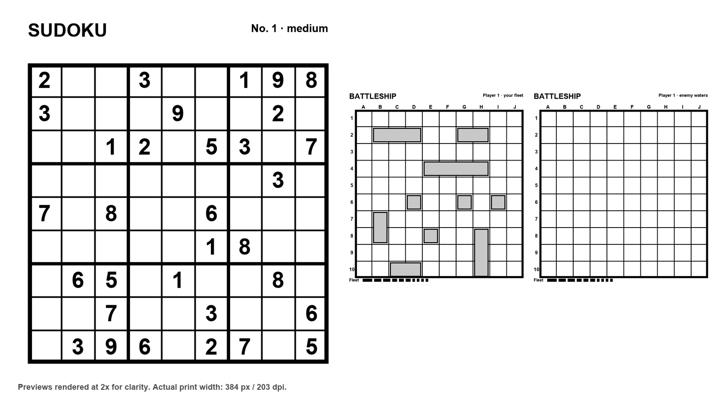

# PrintPlay

**English** | [Русский](README.ru.md)

Print-and-play game templates for thermal printers.

PrintPlay generates ready-to-fill game sheets and prints them on TiMini-compatible
Bluetooth thermal printers. It uses [TiMini-Print](https://github.com/Dejniel/TiMini-Print)
as an external engine for printer discovery, paper geometry, protocol handling,
and raster sending.



*Previews rendered at 2× for clarity. Actual print width: 384 px / 203 dpi.*

## Games

- **Sudoku** — difficulty 1–5, unique solution, one or more puzzles per run.
- **Battleship** — 10×10 fields, standard Russian fleet, automatic placement on
  each player's own field, empty enemy waters for marking shots.

Every run generates a new puzzle or fleet. There is no answer key: print again
for a fresh game.

## Requirements

- Python 3.10+
- [TiMini-Print](https://github.com/Dejniel/TiMini-Print) checkout
- A supported Bluetooth thermal printer (tested with **MXW-W5**, 384 px, 203 dpi)
- Pillow (installed in the TiMini-Print virtualenv)

PrintPlay does not copy or vendor TiMini-Print source code. It imports the
package from a local checkout.

## Quick start

PrintPlay is a thin layer over TiMini-Print, so you need both repositories.
PrintPlay does **not** create a virtualenv automatically; it uses the Python
environment from the TiMini-Print checkout.

### 1. Clone both repositories side by side

```bash
mkdir -p ~/projects
cd ~/projects

git clone https://github.com/Dejniel/TiMini-Print.git timini-print
git clone https://github.com/MarioForte/printplay.git printplay
```

### 2. Create the TiMini-Print virtualenv and install its dependencies

```bash
cd ~/projects/timini-print
python3 -m venv .venv
.venv/bin/python -m pip install --upgrade pip
.venv/bin/python -m pip install -r requirements.txt
```

If you use [`uv`](https://docs.astral.sh/uv/):

```bash
uv venv .venv -p 3.13
uv pip install --python .venv/bin/python -r requirements.txt
```

### 3. Run PrintPlay

```bash
cd ~/projects/printplay
./run.sh
```

`run.sh` uses `../timini-print/.venv/bin/python` and adds the TiMini-Print
checkout to `PYTHONPATH`. If TiMini-Print lives elsewhere:

```bash
TIMINIPRINT_ROOT=/path/to/timini-print ./run.sh
```

### 4. Optional: install the `printplay` and `pnp` commands

```bash
cd ~/projects/printplay
python3 -m pip install -e ".[dev]"
printplay --version
pnp --version
```

The installed commands still need TiMini-Print. PrintPlay finds
`../timini-print` automatically or uses `TIMINIPRINT_ROOT`.

### If the printer is not found

- Make sure the printer is awake and paired.
- On macOS, allow Bluetooth access when the system asks for it.
- Run `./run.sh scan`.
- Try `./run.sh sudoku --bluetooth MXW-W5` or `./run.sh sudoku --model v5x`.

### Dependencies on GitHub

- Pillow is declared in `pyproject.toml`, so GitHub's dependency graph can show
  it and Dependabot can update it.
- TiMini-Print is not a pip package. It is cloned separately and does not appear
  in the Python dependency graph.
- `.github/dependabot.yml` keeps the Python and GitHub Actions dependencies up to date.

## Usage

```bash
# Interactive menu
./run.sh
# The interface language is detected from the OS. Override it with --lang en|ru
# or PRINTPLAY_LANG=en|ru.

# Sudoku, difficulty 1-5
./run.sh sudoku --difficulty 3
./run.sh sudoku --difficulty 5 --count 2

# Battleship: two player sets, four fields total
./run.sh battleship --players 2

# Show the plan and ASCII preview without printing
./run.sh sudoku --difficulty 3 --dry-run

# Scan for printers
./run.sh scan

# List known printer models
./run.sh models
```

The short alias works locally too:

```bash
./pnp sudoku --difficulty 3
./pnp battleship --players 2
```

### Battleship layout

For two players PrintPlay prints four fields, two per player:

1. Player 1 — own fleet, ships already placed;
2. Player 1 — enemy waters, empty grid;
3. Player 2 — own fleet, ships already placed;
4. Player 2 — enemy waters, empty grid.

By default each player's own fleet is pre-placed. Pass `--no-auto-ships` to
print both fields empty, or answer the menu question accordingly. In the
interactive menu, battleship asks only for the number of players and whether to
auto-place ships. The pause is an advanced CLI option (`--pause`); the default
is two seconds between fragments.

Each player's two fields are printed as one fragment. The pair is rotated 90°
on the roll: tear it off, turn the paper, and the own fleet sits on the left
while the empty enemy waters sit on the right. The fleet legend is printed under
each board. The tear-off line and the pause appear only after the pair, so you
do not tear the two boards apart. Then PrintPlay prints the next player's pair.
Change the pause with `--pause`.

### Sudoku layout

Each puzzle is printed on its own fragment at the full printable width. The grid
uses a 5 mm cell on 384 px / 203 dpi paper. Difficulty 1 is the easiest and 5 is
the hardest; every puzzle has exactly one solution. The clue count is used only
to choose the difficulty and is not printed on the sheet.

## Printer detection

PrintPlay asks TiMini-Print to scan Bluetooth and resolve the printer model,
profile, paper preset, width, and DPI. Nothing is hard-coded to one printer.

For the MXW-W5 the engine selects the `v5x` profile and `plain_384r` paper
(384 px, 203 dpi). If automatic detection fails, override it:

```bash
./run.sh sudoku --difficulty 3 --bluetooth MXW-W5
./run.sh sudoku --difficulty 3 --model v5x
./run.sh sudoku --difficulty 3 --paper tag_384r
```

The default print settings are `--image-mode atkinson` and `--darkness 5`.
On the MXW-W5 the grayscale pipeline prints faint; the 1-bit Atkinson pipeline
prints dark. Use `--image-mode threshold` for crisp line art or `--darkness 1-5`
to adjust density.

## Options

```text
--lang en|ru          Interface language (also PRINTPLAY_LANG)
--model KEY           Printer model override
--bluetooth NAME      Bluetooth name or address
--paper KEY           Paper preset override
--image-mode MODE     atkinson, threshold, floyd_steinberg, bayer_4, bayer_8, grayscale
--darkness 1-5        Print density (default: 5)
--auto-ships / --no-auto-ships
                      Auto-place ships on own fields (default: auto)
--pause SECONDS       Pause between fragments (default: 2.0)
--dry-run             Show the plan and ASCII preview, do not print
--keep-png DIR        Save generated pages to DIR for debugging
--yes                 Skip the confirmation prompt (PrintPlay asks by default)
```

## Development

```bash
cd printplay
PYTHONPATH=".:../timini-print" ../timini-print/.venv/bin/python -m pytest -q
```

Optional: install the `printplay` and `pnp` entry points locally:

```bash
python -m pip install -e ".[dev]"
printplay --version
```

PrintPlay finds `../timini-print` automatically; set `TIMINIPRINT_ROOT` if the
checkout lives elsewhere.

The game generators and renderers do not import TiMini-Print, so their tests run
without Bluetooth or printer hardware. GitHub Actions runs the same tests
against the upstream TiMini-Print checkout.

## License

MIT. See [LICENSE](LICENSE).

PrintPlay uses [TiMini-Print](https://github.com/Dejniel/TiMini-Print) as an
external dependency. TiMini-Print is licensed under Apache-2.0. Its source code
is not included in this repository.
